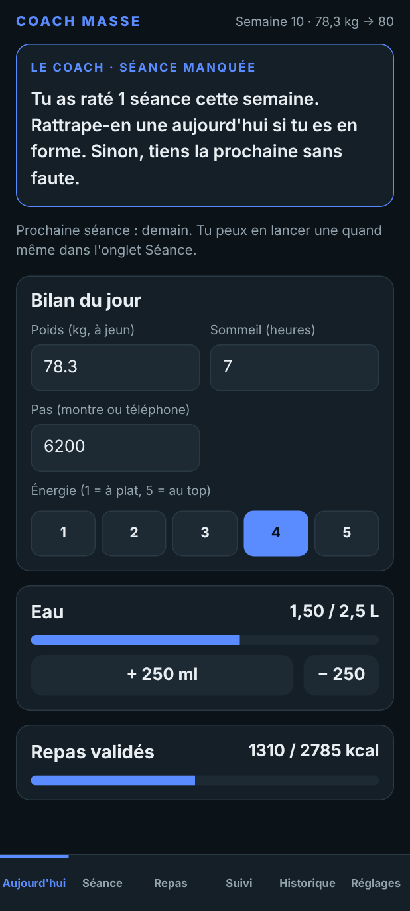
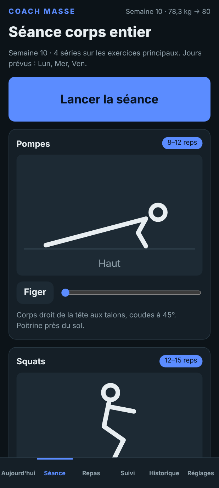
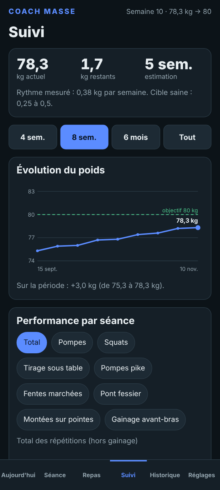
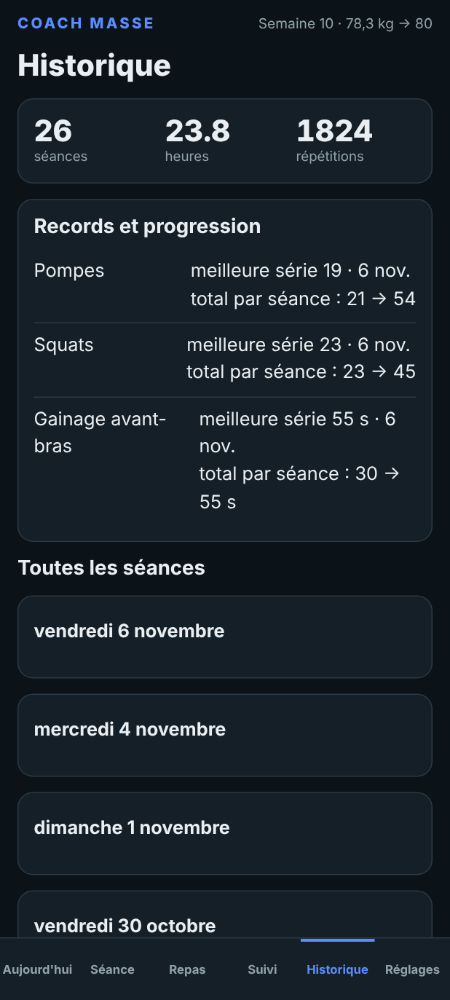
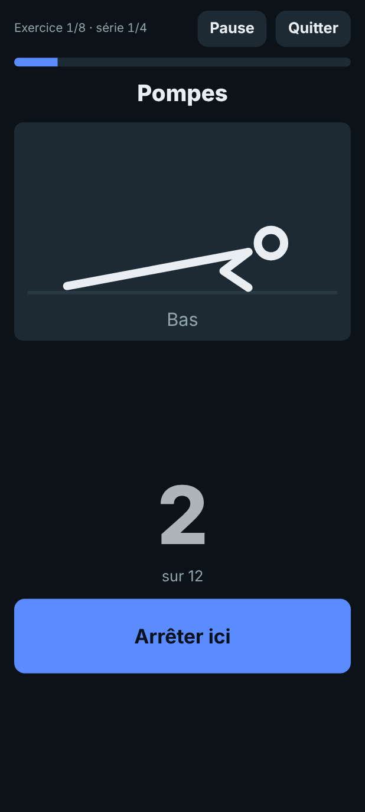
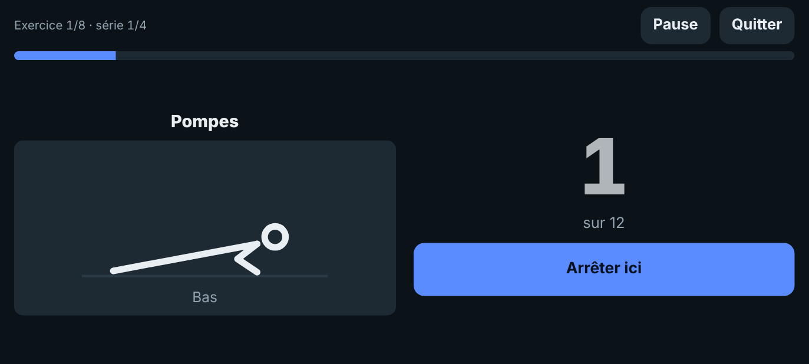

# Coach Masse

Un coach de poche pour prendre du muscle et du poids à la maison, sans salle de sport, sans compte et sans connexion internet.

Version 5 · Application web installable (PWA) · Toutes les données restent sur ton téléphone

  
  
  
  

*Captures réalisées avec des données de démonstration.*

---

## En bref

Coach Masse accompagne une personne mince qui veut gagner de la masse musculaire en s'entraînant chez elle, avec le seul poids du corps. L'application réunit au même endroit :

- **3 séances d'une heure par semaine**, guidées à la voix, avec des dessins animés pour chaque exercice ;
- **un plan de 5 repas par jour** pour atteindre les calories et les protéines nécessaires, même quand l'appétit est petit ;
- **un suivi complet** : poids, performances, mensurations et historique de toutes les séances.

Elle s'installe comme une vraie application sur un téléphone Android, fonctionne sans internet et pèse moins de 100 Ko.

## À quoi ça sert

Prendre du poids sans salle demande trois choses qu'on fait rarement ensemble : s'entraîner régulièrement, manger assez, et mesurer ses progrès. Sans cadre, on saute une séance, on oublie un repas, et on ne sait plus si on avance.

Coach Masse s'occupe de cette organisation :

| Le problème | Ce que fait l'application |
|---|---|
| Je ne sais pas quoi faire comme exercices | Une séance complète de 8 exercices, avec un dessin animé pour montrer le geste |
| Je perds le fil entre les séries et les repos | Le coach parle, compte les répétitions, lance les repos et signale chaque étape par un son |
| Je mange trop peu | 5 repas calibrés (environ 2 800 kcal et 135 g de protéines) et un suivi des repas cochés |
| Je ne vois pas mes progrès | Des courbes de poids et de performance, un tableau semaine par semaine, des records |
| Je ne sais pas quand augmenter la difficulté | L'application passe automatiquement à une variante plus difficile quand l'exercice est maîtrisé |
| Je suis fatigué ou j'ai mal dormi | La séance est allégée d'une série ce jour-là |

**Pour qui ?** Un adulte en bonne santé, plutôt mince, qui veut se muscler à la maison avec son poids du corps et sans matériel.

**Ce que l'application n'est pas.** Elle donne des repères généraux, pas un avis médical. Demande l'avis d'un médecin avant de commencer un programme, surtout si tu fumes beaucoup, si tu as des douleurs ou un essoufflement anormal. Arrête la séance en cas de douleur, de vertige ou de gêne dans la poitrine.

---

## Installer l'application (Android, Chrome)

L'installation se fait une seule fois, avec internet.

1. Ouvre l'adresse de l'application dans **Chrome** : `https://VOTRE-PSEUDO.github.io/coach-masse/`
2. Touche le menu **⋮** puis **Installer l'application** (ou **Ajouter à l'écran d'accueil**).
3. Ouvre l'icône **Coach** et laisse-la charger quelques secondes avec internet.
4. Teste en mode avion : l'application doit s'ouvrir normalement.
5. **Voix du coach.** Dans les réglages Android, ouvre *Système > Langues > Synthèse vocale* et installe les données vocales en **français** pour le moteur Google. Dans l'application, *Réglages > Tester la voix* permet de vérifier.

L'application s'adapte à tous les formats d'écran, en **portrait** comme en **paysage**. Si l'écran refuse de tourner, active la rotation automatique d'Android, puis l'option *Réglages > Affichage > Forcer la rotation de l'écran*.

---

## Utiliser l'application

L'application a six onglets : **Aujourd'hui**, **Séance**, **Repas**, **Suivi**, **Historique** et **Réglages**.

### 1. Premier réglage (2 minutes)

Dans **Réglages**, indique ton poids de départ, ton objectif de poids et tes jours de séance (par défaut lundi, mercredi et vendredi). Choisis aussi la voix, les vibrations, les sons et la cadence qui te conviennent.

### 2. Chaque matin : le bilan du jour (onglet Aujourd'hui)

- Note ton **poids** (à jeun), ton **sommeil**, tes **pas** et ton **énergie** de 1 à 5.
- Ajoute ton **eau** par pas de 250 ml (objectif : 2,5 litres).
- Lis le message du **coach** : il s'adapte à ta journée (jour de séance, récupération, séance manquée, repas restants).
- Si tu dors moins de 6 heures ou si ton énergie est à 1 ou 2, la séance du jour est **allégée d'une série**.

  

### 3. Faire la séance (onglet Séance)

Lance la séance, mets tes écouteurs et pose le téléphone. L'écran reste allumé et tout se fait à la voix.

1. **Échauffement** de 4 minutes : sauts légers, rotations des épaules, squats lents, pompes lentes.
2. Pour chaque série : un compte à rebours de 6 secondes pour te placer, puis le **dessin animé** montre le geste à la cadence réglée. Le coach **compte les répétitions** à voix haute.
3. **Repos** automatique. Un bouton permet d'ajouter 15 secondes ou de passer. Le dessin montre l'exercice suivant.
4. À la fin de chaque série, ajuste le nombre de répétitions réussies si besoin, avec **+** et **−**.
5. **Bilan de séance** : durée, séries, répétitions et passages au niveau supérieur.

L'onglet **Séance** présente aussi chaque exercice avec un curseur pour **décomposer le mouvement** pas à pas.

  
  &nbsp;&nbsp;
  

### 4. Les repas (onglet Repas)

Coche chaque repas quand tu l'as fini : la barre de calories se remplit. Des variantes sont proposées (sans poulet, petit appétit, budget serré), ainsi qu'une liste de courses de la semaine.

### 5. Suivre ses progrès (onglets Suivi et Historique)

- **Suivi** : courbe de poids avec ton objectif, performance par séance (total ou par exercice), tableau semaine par semaine, mensurations (bras, poitrine, taille, cuisse). Un sélecteur permet de voir 4 semaines, 8 semaines, 6 mois ou tout.
- **Historique** : toutes tes séances sont conservées, avec le détail des répétitions par série, tes records et ta progression. Une séance peut être supprimée en deux appuis.
- Si ton poids monte trop lentement, l'application propose d'ajouter 300 kcal par jour. S'il monte trop vite, elle propose d'en retirer 200.

---

## Les 8 exercices

Les deux premières semaines, chaque exercice compte 3 séries. Ensuite, les pompes, les squats, le tirage et les fentes passent à 4 séries.

| Exercice | Répétitions | Repos | Muscles | Niveaux de progression |
|---|---|---|---|---|
| Pompes | 8 à 12 | 60 s | Pectoraux, triceps, épaules | Pompes, pieds surélevés, pieds surélevés avec descente lente, pompes archer |
| Squats | 12 à 15 | 60 s | Cuisses, fessiers | Squats, avec sac à dos, squat bulgare, bulgare avec sac à dos |
| Tirage sous une table | 8 à 12 | 75 s | Dos, biceps | Genoux fléchis, jambes tendues, pieds sur une chaise, tractions si tu as une barre |
| Pompes pike | 6 à 10 | 75 s | Épaules, triceps | Pike, pieds surélevés, pieds très surélevés |
| Fentes marchées | 10 à 12 par jambe | 60 s | Cuisses, fessiers, équilibre | Fentes, avec sac à dos, avec sac à dos lourd |
| Pont fessier | 12 à 15 | 45 s | Fessiers, arrière des cuisses, bas du dos | Pont, sur une jambe, sur une jambe avec pied surélevé |
| Montées sur pointes | 15 à 20 | 45 s | Mollets | Deux jambes, une jambe, une jambe avec sac à dos |
| Gainage sur les avant-bras | 30 à 45 s | 45 s | Abdominaux, dos, épaules | Gainage, avec levée de jambe, bras tendus |

*Le repos réel ajoute 15 secondes à ces valeurs. Ce supplément se règle dans Réglages.*

**Progression automatique.** Quand tu atteins le haut de la fourchette sur toutes les séries, l'application passe à la variante suivante. Arrivé au dernier niveau, l'objectif augmente de 2 répétitions (5 secondes pour le gainage).

**Matériel.** Une table stable, une chaise et un sac à dos que l'on charge avec des bouteilles d'eau ou des livres. Une barre de traction est facultative.

---

## Le plan alimentaire

Une journée type, pensée pour environ **2 785 kcal** et **136 g de protéines** :

| Heure | Repas | kcal | Protéines |
|---|---|---|---|
| 9 h 30 | Omelette de 3 œufs, pain, huile d'olive, lait au chocolat | 660 | 32 g |
| 12 h | Smoothie de lait, bananes, flocons d'avoine et beurre de cacahuète | 650 | 21 g |
| 14 h 30 | Poulet ou sardines, riz, légumes, huile d'olive | 670 | 40 g |
| 18 h | Pain à l'amlou et yaourt | 330 | 12 g |
| 21 h 30 | Lentilles ou pois chiches, 2 œufs, pain | 475 | 31 g |

Boire ses calories (le smoothie) est la clé quand l'appétit est petit. Adapte les heures à ton rythme. Ces quantités sont des repères, pas une prescription.

---

## Les signaux sonores

Chaque étape de la séance a son propre son, pour pouvoir t'entraîner sans regarder l'écran. La plupart des signaux s'accompagnent d'une vibration et, aux moments clés, d'un cadre coloré qui clignote autour de l'écran.

| Moment | Signal |
|---|---|
| 3, 2, 1 avant un départ ou une fin | Bips courts |
| Début d'une série | Bip aigu |
| Pendant les répétitions | Métronome : bip grave à la descente, bip aigu à la montée |
| Gainage | Signal à la moitié et à 10 secondes de la fin, tic toutes les 5 secondes si le métronome est activé |
| Fin d'une série | Trois notes descendantes |
| Fin d'un exercice | Trois notes descendantes puis deux notes montantes |
| 10 secondes avant la fin du repos | Double bip |
| Fin du repos | Trois notes montantes (quatre si l'exercice change) |
| Fin de la séance | Fanfare |

Le volume, le métronome et chaque signal se règlent et se testent dans **Réglages**.

---

## Tes données

- **Tout reste sur ton téléphone**, dans l'espace de stockage de l'application. Il n'y a ni compte, ni publicité, ni suivi, ni envoi de données. Le réseau sert seulement à charger l'application et ses mises à jour.
- **Les données ne sont pas chiffrées par l'application.** Elles sont protégées par le verrouillage de ton téléphone.
- **Sauvegarde.** *Suivi > Exporter* crée un fichier de sauvegarde, *Importer* le recharge. Ce fichier est lisible en clair : garde-le en lieu sûr.
- **Effacement.** *Réglages > Données > Effacer toutes les données*. Vider les données de Chrome efface aussi tout : exporte avant.
- **Hors ligne.** Après la première ouverture, l'application fonctionne sans internet. Quand tu as internet, elle se met à jour toute seule. La version affichée en bas de *Réglages* permet de vérifier.

---

## Pour le développeur

Le projet est une application web statique : du HTML, du CSS et du JavaScript, sans bibliothèque ni outil de compilation.

| Fichier | Rôle |
|---|---|
| `index.html` | Page unique et barre de navigation |
| `app.js` | Toute la logique : séance guidée, animations, sons, graphiques, historique |
| `styles.css` | Styles, thèmes clair et sombre, adaptation portrait et paysage |
| `sw.js` | Service worker : fonctionnement hors ligne et mises à jour |
| `manifest.webmanifest` | Réglages d'installation (nom, icônes, orientation) |
| `icon-192.png`, `icon-512.png` | Icônes de l'application |

**Publier ou mettre à jour avec GitHub Pages.** Dans le dépôt, *Add file > Upload files* pour envoyer ou remplacer les fichiers, puis *Settings > Pages*, branche `main`, dossier `/ (root)`. Les fichiers sont rechargés depuis le réseau dès qu'il est disponible. Pour forcer le nettoyage de l'ancien cache, change son nom dans `sw.js` (par exemple `coach-masse-v5` devient `coach-masse-v6`).

**Compatibilité.** L'application est conçue pour Chrome sur Android. La mise en page a été vérifiée avec des largeurs d'écran de 320 à 1 180 pixels, en portrait et en paysage. Les autres navigateurs n'ont pas été testés.

## Feuille de route

- Une boîte à avis pour recueillir des commentaires, avec envoi chiffré de bout en bout et sans serveur (à l'étude).
- Un chiffrement facultatif des données locales avec un code secret (à l'étude).
- Un rappel de séance, aujourd'hui possible seulement avec l'application Horloge du téléphone.
